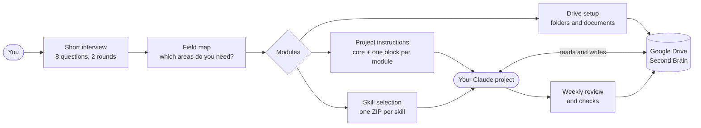
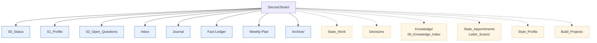
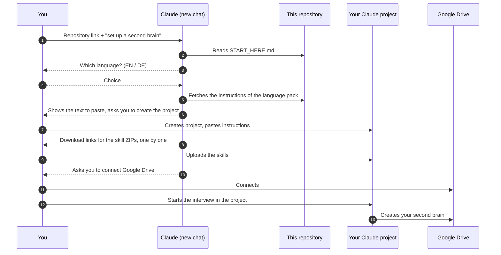

# For developers and the curious

This page is the technical side of the [second-brain-kit](README.md): how it is built, how it is set up by hand, what exactly has been tested and how the repository is checked. The [README](README.md) explains the same kit in everyday words.

## How it works



The interview has two stages. The first is short, eight questions at most, and only decides which areas you need. The second asks about each area in turn. You can stop at any point and pick up later, because every answer is written to your Drive the moment you give it.

From your answers come three things: the project instructions, the list of skills to upload and the folder with its documents in Drive. After that, everyday use is plain conversation. Claude reads your status first, answers, and files what belongs somewhere.

### What lands in your Drive



The solid boxes are the core and always exist. A dashed box only appears if the interview switched the matching area on.

## The areas

The core is always there. Everything else is an area the interview can switch on. Some areas only need a document, others bring a skill along.

| Area | What it holds | Skills |
|---|---|---|
| **Core** (always) | Status, profile, open questions, inbox, journal, fact ledger, weekly plan | `setup-brain`, `onboarding-interview`, `fact-check`, `weekly-review`, `brain-check` |
| Person | Who you are, how you like to be addressed, your rules and limits | none |
| Tools | Which tools and apps you use | none |
| Work | Work, goals, evidence of what is done | `transcript-minutes` (optional) |
| Decisions | Open and taken decisions, with the reason | `decision-clarify`, `decision-check` |
| Family | State of family matters | none |
| Knowledge | One note per researched topic, with sources | `knowledge-note` |
| Appointments | Appointments, deadlines, post, evidence | `appointment-prep`, `letter-explain` |
| Learning | State of what you are learning, practice log | none |
| Writing style | Plain-prose editing, optionally your own style profile | `plain-prose-de`, `plain-prose-en` (add-on: `style-profile`) |
| Build | Small apps, scripts and automations, built with an AI coding tool | `build-router`, `vibe-pack` |
| Own areas | Anything else you name | none |

Areas can be added, paused and updated later with the add-on `area-manager`.

## The skills

Every skill is one `SKILL.md` in its own ZIP. The skills come in three groups, so you only upload what you need. Each one has its own page with a flow diagram, an example, its limits and what has really been tested: see [`skills/`](skills/README.md).

**Always there (core)**

- [`onboarding-interview`](skills/onboarding-interview.md) `asks eight short questions in two rounds and shows which areas become active`
- [`setup-brain`](skills/setup-brain.md) `creates the folder and documents in Drive, never overwrites, can run again`
- [`weekly-review`](skills/weekly-review.md) `sorts the inbox, asks three questions and plans the next week`
- [`fact-check`](skills/fact-check.md) `checks numbers, deadlines and rules against a source and records them`
- [`brain-check`](skills/brain-check.md) `checks the second brain for order and proposes repairs`

**Switched on by the interview (module skills)**

- [`decision-clarify`](skills/decision-clarify.md) `finds the few questions whose answer would tip a decision`
- [`decision-check`](skills/decision-check.md) `gives a decision you call final exactly one blind-spot check`
- [`knowledge-note`](skills/knowledge-note.md) `files researched knowledge as one note per topic, with sources`
- [`appointment-prep`](skills/appointment-prep.md) `prepares an appointment or records what was agreed`
- [`letter-explain`](skills/letter-explain.md) `explains a letter in plain words: what to do, by when, what protects you`
- [`plain-prose-de`](skills/plain-prose-de.md), [`plain-prose-en`](skills/plain-prose-en.md) `edit texts for clarity, brevity and active language, keeping your voice`
- [`build-router`](skills/build-router.md) `entry point for anything you want built; builds nothing itself and hands over`
- [`vibe-pack`](skills/vibe-pack.md) `turns a vague idea into a rules file and build plan for a coding agent`

**Add-ons (offered when they fit)**

- [`transcript-minutes`](skills/transcript-minutes.md) `turns a transcript into verified minutes with decisions and tasks`
- [`style-profile`](skills/style-profile.md) `derives your style profile from two or three of your own texts`
- [`area-manager`](skills/area-manager.md) `adds, pauses and updates areas later`
- [`skill-tailor`](skills/skill-tailor.md) `builds a version of a skill fitted to you`

The last one deserves a word. Most skills come ready-made. `skill-tailor` takes a template, asks you three to five short choices and builds a version of the skill fitted to you, as a ZIP in the chat. Only marked passages change. The fixed parts (limits, privacy, writing format, check line, source rules) stay word for word, and a check confirms that before you get the file. Templates exist for `appointment-prep` and `letter-explain`. It needs code execution; without it you take the ready-made ZIP.

## Setting it up

### The short way: give Claude the link

1. Open a new chat in claude.ai.
2. Paste the link to this repository and write: *"Set up a second brain for me with this."*
3. Claude reads [`START_HERE.md`](START_HERE.md), asks which language you want and walks you through every step, one at a time.



Claude reads the repository, picks the right files, shows you the exact text to paste and waits for your confirmation at every step. A few things only you can do: create the project, paste the instructions, upload the ZIPs and connect Google Drive. The interview and the Drive setup then run inside the project.

This only works if the repository is public and your account can open links. If Claude cannot read it, `START_HERE.md` tells it to ask you for the downloaded files instead.

### The manual way

The same steps without the guide.

1. **Accounts.** A Claude account (the free plan is enough) and a Google account. Try it in a separate test account first, ideally one that holds no documents other people have shared with it.
2. **Pick a language pack**, `en/` or `de/`. The pack sets the language of the instructions, the skills, the questions and the document names in your Drive. English is the source language; German is the pack that has been walked through.
3. **Create a Claude project** and paste the core project instructions from the pack.
4. **Turn on code execution** (Settings, Capabilities). Skills do not work without it.
5. **Upload the skills** from `<pack>/dist/`, one ZIP per skill. The core first, then only what the interview asks for.
6. **Connect Google Drive** in the connector settings.
7. **Start the interview.** Say that you want to set up your second brain.
8. **Run the setup.** Claude lists what it is going to create, asks once, creates the folder and documents and reports what exists and what is missing.
9. **Leave the project knowledge empty.** Claude reads `00_Status` from Drive at the start of every chat. A copy in the project knowledge can go stale, and in a test it did.
10. **Paste the account text.** The setup prints a short text for your account preferences, so chats outside the project also know where your Drive folder is.

## What keeps it honest

A second brain is only useful if you can trust what it says. The kit relies on a few plain rules for that.

- **Every entry says where it came from.** Value, status (`answered`, `open`, `unknown`, `skipped`), origin (`user`, `companion`, `derived`, `unknown`) and date. "Unknown" never turns into "certain".
- **A check line on every consequential answer.** One line at the top saying what was read, and one at the end saying where something was filed. You can see at a glance whether Claude looked. The line at the top matters: when it sat at the end, Claude answered first and stopped reading Drive (finding F72).
- **Facts carry sources.** Numbers, deadlines and rules go through `fact-check` into the fact ledger, with source, date and status. Without a source they stay marked as unchecked.
- **Nothing is deleted or renamed without asking**, and nothing is sent in your name without a clear yes. Old values are kept, not overwritten.
- **Some things are never stored:** ID, account, tax and insurance numbers.
- **Decisions keep their reason.** A decision you call final gets exactly one blind-spot check before it is acted on.

## Known limits

Be clear about what kind of safety this is. Every rule above is an instruction that Claude follows. None of it is enforced from outside. The check line makes slips visible; it does not make them impossible. In testing, the rules held in most cases and failed in a few, and those failures are why several of them are now worded the way they are.

The platforms add their own limits. A free Claude account has a message limit that a full walkthrough can reach. Nothing is lost when that happens, because everything done so far is already in Drive, and you continue once the limit resets. Project instructions are length-limited, so the core instructions stay under 5,000 characters. A ZIP may contain only one skill. In a test, claude.ai accepted 16 skills in one account without complaint (2026-11-11); the kit sets no upper limit, but uploading only what the interview suggests keeps the choice of skill clear.

The setup has further targets: at most eight questions in the first stage (about five minutes), at most 15 Drive actions and at most 20 minutes in total. The first two are met in simulation. The time is not: setup currently takes about 21 to 25 minutes.

## Status

Three words are used with care. **Ran** means it ran in a real claude.ai account. **Checked** means a tool in this repository checked it. **Draft** means written, not run.

What has run, in the German pack in a free test account with an invented person:

- A free Claude account can run custom skills, and a ZIP may hold only one of them (a bundle was rejected).
- Creating Drive documents and writing into existing Google Docs and Sheets through the connectors, also from the phone app, checked against a Drive export (2026-11-04 to 2026-11-10).
- Reading `00_Status` from Drive at the start of every chat instead of using the project knowledge (seen 2026-11-10).
- The guided start from the repository link, the interview and the setup (2026-11-04). The link itself was readable; raw links derived from it were not, so the fallback is to attach the files. The fixes made since then have not been re-run from a fresh start.
- `weekly-review`, `fact-check`, `brain-check` (2026-11-05 to 2026-11-10).
- `decision-clarify`, `decision-check`, `knowledge-note`, `area-manager` (2026-11-05 and 2026-11-06).
- `letter-explain`, a tailored `appointment-prep` and `skill-tailor` 0.4, once each (2026-11-10): a letter explained and a reply drafted; `skill-tailor` built a checked ZIP that claude.ai accepted and that worked in use. `skill-tailor` 0.5 and the fixed `appointment-prep` have not run yet.
- Phone use, partly: writing into documents from the phone worked once. Setup is still best done on a computer.

What is checked by tools: spec consistency (`tools/spec_pruefen.py`), the core skills against the spec word for word (`tools/skelett.py`), and the structure of the two language packs (`tools/lang_parity.py`, structure only, not the quality of the wording).

What is still draft:

- `plain-prose-*`, `style-profile`, `transcript-minutes`, `build-router`, `vibe-pack`. The German pack is tool-checked; the English pack is checked for structure, and `vibe-pack` and `transcript-minutes` also by their skill checks (their self-tests are German only). None of them has run in claude.ai yet.
- The English pack as a whole. Its checks pass, but no native speaker has reviewed the wording and it has never run in a real account.

The [gates page](skills/GATES.md) lists which check each skill has passed.

## Repository and checks

```text
second-brain-kit/
├── README.md
├── START_HERE.md      # instructions for Claude when you hand it the link
├── LICENSE            # MIT
├── llms.txt  AGENTS.md   # entry points for assistants: llms.txt for the setup, AGENTS.md for work on the repository
├── PRIVACY.md  SECURITY.md  CONTRIBUTING.md  UPDATING.md  CHANGELOG.md
├── .github/           # issue and pull request templates
├── en/                # English pack (source language)
│   ├── spec/          # modules, questions, profile schema, field map
│   ├── skills/        # one folder per optional skill, each with one SKILL.md
│   ├── skeleton/      # core instructions and the three core skills
│   └── dist/          # prebuilt skill ZIPs, one skill per ZIP
├── de/                # German pack, same structure (plus invented test personas)
├── skills/            # one page per skill with flow diagram, example, limits, test status; gates page
├── docs/              # test guides and skill documentation (plain-prose, style-profile, transcript-minutes, vibe-pack)
└── tools/             # checks, the ZIP builder, an example check workflow (tools/ci)
```

The checks need Python 3 and PyYAML. They test structure and consistency, not whether a skill works in a real account.

```text
python3 tools/spec_pruefen.py en/spec          # modules, questions, fields, cross-references
python3 tools/skelett.py pruefen en            # core skills against the spec, word for word
python3 tools/plain_prose_pruefen.py skills en # plain-prose skills
python3 tools/lang_parity.py pruefen de en     # the two language packs have the same structure
python3 tools/zip_bauen.py en                  # rebuild the skill ZIPs into en/dist
```

The tool and file names are in German for historical reasons and will be renamed. More languages can be added as further packs; the IDs of questions, modules and fields are the same in every pack, and the parity check keeps them aligned.

Updating changes the skills and instructions, never your documents. See [UPDATING.md](UPDATING.md) and the [CHANGELOG](CHANGELOG.md).

## Roadmap

Done: the concept, a first walkthrough with an invented person, a round of fixes from it, the core and the decision, knowledge and appointment skills, `brain-check` and `build-router` as drafts, and both language packs with a parity check.

Next:

- Port the language-bound content checks (`vibe-pack`, `transcript-minutes`) to the English pack.
- A second walkthrough with the fixed skeleton.
- The guided start from the repository link, tested in a clean account.
- The stage 2 question catalogue and instruction blocks for all modules.
- A handbook for non-technical users.
- The first tagged release.
