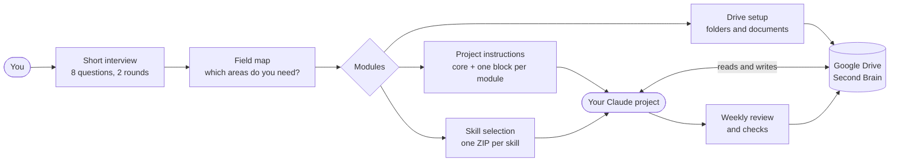
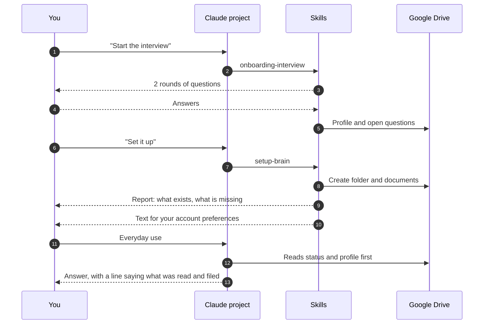
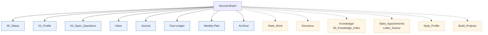
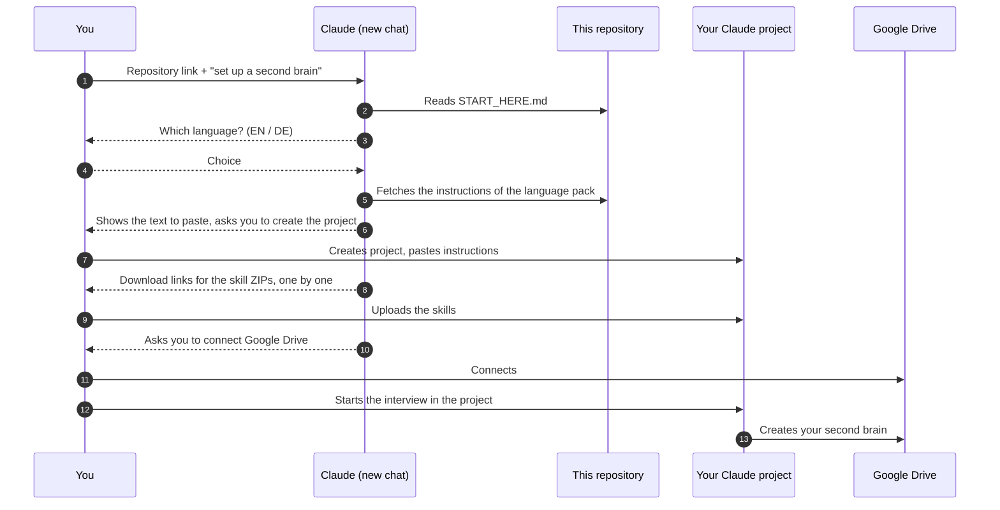

# second-brain-kit

> A second brain for ordinary people. Runs on **claude.ai + Google Drive**. Nothing to install.


A short interview decides what *your* second brain needs. A set of skills then builds it in your own Google Drive, and keeps it tidy from there. No Claude Desktop, no Obsidian, no terminal, no scripts you have to run.

> [!WARNING]
> **Draft.** The concept has been walked through once in a free Claude account with an invented person. Most skills in this repo are first drafts that have not been tested yet. See [Status](#status) for what is verified and what is not.

## Contents

- [Why this exists](#why-this-exists)
- [How it works](#how-it-works)
- [What you get](#what-you-get)
- [Quick start: give Claude the link](#quick-start-give-claude-the-link)
- [Manual start](#manual-start)
- [Design principles](#design-principles)
- [Limits you should know](#limits-you-should-know)
- [Languages](#languages)
- [Status](#status)
- [Repository layout](#repository-layout)
- [Checks](#checks)
- [Updating](#updating)
- [Roadmap](#roadmap)
- [Privacy and contributions](#privacy-and-contributions)
- [License](#license)

## Why this exists

Most second-brain setups assume you are comfortable with local tools, plugins and folders full of Markdown. Most people are not, and they should not have to be. They already have a Google account and a chat window.

This kit takes a different route:

- **Google Drive is the single source of truth.** Everything the assistant needs to remember is written to documents you can open, read and edit yourself.
- **The assistant does not rely on its own memory.** Chat memory is a black box. Documents are not.
- **The structure is decided by an interview**, not by a template you have to bend to fit.
- **Everything runs in the chat.** The setup, the weekly review and the checks are skills, not programs.

## How it works



The interview has two stages. **Stage 1** is short (at most eight questions) and picks the modules. **Stage 2** asks module-specific questions, one area at a time, and can be paused and resumed because every answer is written to your Drive immediately.

### Who talks to whom



## What you get

A core that is always there, plus modules that the interview switches on.

Every skill has its own page with a flow diagram, an example, its limits and its test status: see [`skills/`](skills/README.md) and the [gates](skills/GATES.md).

| Part | What it does | Skills |
|---|---|---|
| **Core** (always) | Status, profile, open questions, inbox, journal, fact ledger, weekly plan (areas can be added, paused and updated later with the optional add-on `area-manager`) | `setup-brain`, `onboarding-interview`, `fact-check`, `weekly-review`, `brain-check` |
| Person | Who you are, how you like to be addressed, your rules and limits | none |
| Tools | Which tools and apps you use | none |
| Work | Work, goals, evidence of what is done | `transcript-minutes` (optional) |
| Decisions | Open and taken decisions, with the reason | `decision-clarify`, `decision-check` |
| Family | State of family matters | none |
| Knowledge | One note per researched topic, with sources | `knowledge-note` |
| Appointments | Appointments, deadlines, post, evidence | `appointment-prep`, `letter-explain` |
| Learning | State of what you are learning, practice log | none |
| Writing style | Plain-prose editing; optional add-on `style-profile` builds your style profile from your own texts | `plain-prose-de`, `plain-prose-en` (add-on: `style-profile`) |
| Build | Small apps, scripts and automations, built with an AI coding tool | `build-router`, `vibe-pack` |
| Own areas | Anything else you name | none |

### Two kinds of skills

**A. Out of the box.** Ready-made ZIPs in `de/dist` and `en/dist`, one skill per ZIP.

| | Kind | Skills | Upload |
|---|---|---|---|
| A1 | Core, always | `setup-brain`, `onboarding-interview`, `weekly-review`, `fact-check`, `brain-check` | always |
| A2 | Module skills, switched on by the interview | `decision-clarify`, `decision-check`, `knowledge-note`, `appointment-prep`, `letter-explain`, `plain-prose-de`, `plain-prose-en`, `build-router`, `vibe-pack` | counted: at most 12 uploads together with the core |
| A3 | Add-ons, offered when they fit | `transcript-minutes`, `style-profile`, `area-manager`, `skill-tailor` | outside the 12 |

**B. Tailored to you (draft, not run in claude.ai).** Claude reads a skill from the repository only as a template, asks a short interview (single or multiple choice, recommendation first) and builds the skill for you as a ZIP in the chat. Only marked passages change. The fixed blocks (limits, privacy, writing format, check line, source rules) stay word for word and are checked. The add-on `skill-tailor` does this; templates exist so far for `appointment-prep` and `letter-explain` (`<pack>/spec/vorlagen/`). It needs code execution; without it, or for any other skill, you take the ready-made ZIP of kind A.

### What lands in your Drive



Solid boxes are the core. Dashed boxes appear only if the interview switched the matching module on.

## Quick start: give Claude the link

The goal is that you only hand Claude the link to this repository and it guides you through the whole setup on its own.

1. Open a new chat in claude.ai.
2. Paste the link to this repository and write: *"Set up a second brain for me with this."*
3. Claude reads [`START_HERE.md`](START_HERE.md), asks which language you want, and walks you through every step, one at a time.



What Claude can do for you and what you still do by hand:

| Claude does | You do |
|---|---|
| Reads this repository and picks the right files | Create the Claude project (one click) |
| Shows the exact text to paste, in your language | Paste the instructions and upload the skill ZIPs |
| Explains each step and waits for your confirmation | Connect Google Drive and confirm the permissions |
| Runs the interview and builds the Drive structure (inside the project) | Nothing; the project knowledge stays empty |

> [!IMPORTANT]
> Claude can only read this repository if it is **public**, and only if your Claude account can open links. If it cannot, `START_HERE.md` tells Claude to ask you for the downloaded repository instead. Guided start from a link is the target and has **not been tested yet**.

## Manual start

> [!NOTE]
> These steps describe the same flow without the guide. Parts of it are verified in a free Claude account, parts are not. See [Status](#status).

1. **Accounts.** A Claude account (the free plan is enough for the walkthrough) and a Google account. Use a separate test account first, not your main one. Ideally the Google account holds no documents that other people shared with it.
2. **Pick a language pack.** Choose `en` or `de` (see [Languages](#languages)).
3. **Create a Claude project** and paste the core project instructions from the pack.
4. **Turn on code execution, then upload the skills.** Skills do not work without code execution (Settings, Capabilities). Each skill is its own ZIP with exactly one skill inside, prebuilt in `<pack>/dist/` (`en/dist/` or `de/dist/`). Upload the three core skills first, then at most the skills the interview asks for (the budget is 12).
5. **Connect Google Drive** in the connector settings.
6. **Start the interview.** Say that you want to set up your second brain.
7. **Run the setup.** Ask the assistant to set it up. It lists what it is going to create, asks once, then creates folder and documents and reports what exists and what is missing.
8. **Leave the project knowledge empty.** The assistant reads `00_Status` from Drive at the start of every chat; a copy in the project knowledge can go stale (it did in a test).
9. **Paste the account text.** The setup skill prints a short text for your account preferences. It makes chats outside the project aware of your Drive folder.

## Design principles

- **One source of truth.** Drive. If it is not in a document, the assistant does not know it.
- **Every entry says where it came from.** Value, status (`answered`, `open`, `unknown`, `skipped`), origin (`user`, `companion`, `derived`, `unknown`) and date.
- **"Unknown" never means "certain".** Missing facts stay marked as missing.
- **A visible check line.** Every consequential answer starts with one line saying what was read and where something was filed. It is a signal, not a guarantee.
- **Facts carry sources.** Numbers, deadlines and rules go through `fact-check` and the fact ledger, with source, date and status.
- **Nothing is deleted or renamed** without being asked. The assistant never sends anything in your name without a clear yes.
- **Never stored:** ID, account, tax and insurance numbers.
- **Decisions are recorded with the reason**, and a decision declared final gets exactly one blind-spot check before it is acted on.
- **Small by design.** Skills stay short and each skill has one job.

## Limits you should know

The kit is built to feel approachable. These budgets are targets for the setup, not promises:

| Budget | Target | Status |
|---|---|---|
| Stage 1 of the interview | at most 8 questions, about 5 minutes | meets the target in simulation |
| Skill uploads | at most 12 | by design |
| Drive actions during setup | at most 15 | meets the target in simulation |
| Setup time | at most 20 minutes | **not met yet**, about 21 to 25 minutes in simulation |

Other limits come from the platforms. A free Claude account has a message limit that a full walkthrough can reach. Everything done so far is in Drive, so you can continue after the limit resets. Project instructions are length-limited, so the core instructions stay under 5,000 characters. A ZIP may contain only one skill.

## Languages

The kit comes in two language packs, **English** and **German**. You choose one when you install it. The pack decides the language of the project instructions, the skills, the interview questions and the names of the documents in your Drive.

| Pack | Folder | Note |
|---|---|---|
| English | `en/` | source language of this repository |
| German | `de/` | the first pack that was walked through |

More languages can be added as further packs. The structure (question IDs, module IDs, field IDs) is the same in every pack, and a parity check keeps the packs aligned.

## Status

What the labels mean: **verified** = checked in a real run, **checked** = checked by a tool in the repo, **draft** = written, not run.

| Area | State | How we know |
|---|---|---|
| Free Claude account can run custom skills | verified | one walkthrough with an invented person |
| One skill per ZIP | verified | a bundle of several skills was rejected |
| Project knowledge | not used | a copy in the project knowledge went stale in a test; the assistant now reads `00_Status` from Drive at the start of every chat (seen 2026-11-10) |
| Creating and editing Drive documents from the chat | verified | same walkthrough |
| Writing into existing Google Docs and Sheets through the Google Docs and Sheets connectors | verified | free test account, 2026-11-04 to 2026-11-10, also from the phone app; checked against a Drive export |
| Spec consistency (modules, questions, fields, cross-references) | checked | `tools/spec_pruefen.py` |
| Skeleton skills match the spec word for word | checked | `tools/skelett.py` |
| Parity between language packs | checked | `tools/lang_parity.py` (structure only, not the quality of the wording) |
| English pack | draft | spec, skeleton and plain-prose checks pass; wording not reviewed by a native speaker; never run in a real account |
| `weekly-review`, `fact-check`, `brain-check` | ran | German pack, free test account, 2026-11-05 to 2026-11-10 |
| `decision-clarify`, `decision-check`, `knowledge-note`, `area-manager` | ran | German pack, free test account, 2026-11-05 and 2026-11-06 |
| `plain-prose-*`, `style-profile`, `transcript-minutes`, `build-router`, `vibe-pack` | draft | German pack tool-checked; English pack checked for structure and, for `vibe-pack` and `transcript-minutes`, by the skill checks (their self-tests are German only); not run in claude.ai yet |
| `letter-explain`, `appointment-prep` (tailored), `skill-tailor` 0.4 | ran once | German pack, free test account, 2026-11-10: a letter explained and a reply drafted; `skill-tailor` built a checked ZIP that claude.ai accepted and that worked in use. `skill-tailor` 0.5 and the fixed `appointment-prep` have not run yet |
| Guided start from the repository link and setup | ran | 2026-11-04 in a free test account: the link was readable, raw links derived from it were not (fallback: attach the files); interview and setup worked. The fixes since then have not been re-run from a fresh start |
| Phone use | partly verified | writing into documents from the phone app worked once; setup is still recommended on a computer |

Known gaps are listed in the status table above and in the [Roadmap](#roadmap).

## Repository layout

Layout of the repository:

```text
second-brain-kit/
├── README.md
├── START_HERE.md      # instructions for Claude when you hand it the link
├── LICENSE            # MIT
├── llms.txt  AGENTS.md   # entry points for assistants: llms.txt for the setup, AGENTS.md for work on the repository
├── PRIVACY.md  SECURITY.md  CONTRIBUTING.md  UPDATING.md  CHANGELOG.md
├── .github/           # issue and pull request templates
├── en/                # English pack (source language)
│   ├── spec/          # modules, questions, profile schema, field map
│   ├── skills/        # one folder per optional skill, each with one SKILL.md
│   ├── skeleton/      # core instructions and the three core skills
│   └── dist/          # prebuilt skill ZIPs, one skill per ZIP
├── de/                # German pack, same structure (plus invented test personas)
├── skills/            # one page per skill with flow diagram, example, limits, test status; gates page
├── docs/              # test guides and skill documentation (plain-prose, style-profile, transcript-minutes, vibe-pack)
└── tools/             # checks, the ZIP builder, an example check workflow (tools/ci)
```

## Checks

The checks need Python 3 and PyYAML. They test structure and consistency, not whether a skill works in a real account.

```text
python3 tools/spec_pruefen.py en/spec          # modules, questions, fields, cross-references
python3 tools/skelett.py pruefen en            # core skills against the spec, word for word
python3 tools/plain_prose_pruefen.py skills en # plain-prose skills
python3 tools/lang_parity.py pruefen de en     # the two language packs have the same structure
python3 tools/zip_bauen.py en                  # rebuild the skill ZIPs into en/dist
```

The tool and file names are in German for historical reasons and will be renamed.

## Updating

Updating changes the skills and instructions, not your documents. See [UPDATING.md](UPDATING.md) and the [CHANGELOG](CHANGELOG.md).

## Roadmap

- [x] Concept: interview, modules as data, skills, Drive as source of truth
- [x] Walkthrough in a free Claude account with an invented person
- [x] First round of fixes from that walkthrough
- [x] Core and decision, knowledge, appointment skills as drafts
- [x] English and German packs with a parity check
- [ ] Port the language-bound content checks (`vibe-pack`, `transcript-minutes`) to the English pack
- [ ] Second walkthrough with the fixed skeleton
- [ ] Guided start from the repository link, tested in a clean account
- [ ] Stage 2 question catalogue per module
- [ ] Module instruction blocks for all modules
- [x] `brain-check` and `build-router` as drafts (not run in a real account)
- [ ] Handbook for non-technical users
- [ ] First tagged release

## Privacy and contributions

- This repository contains **no real personal data**. All test persons are invented.
- Your answers, profile and documents live only in **your** Google Drive. Read the [privacy notice](PRIVACY.md) (a draft, not legal advice).
- Please do not open issues or pull requests that contain real personal data, credentials or copyrighted text. See [CONTRIBUTING.md](CONTRIBUTING.md) and [SECURITY.md](SECURITY.md).
- Not affiliated with Anthropic or Google. "Claude" and "Google Drive" are named only to say what the kit runs on.

## License

To be decided before the first release. Until then, no license is granted.
