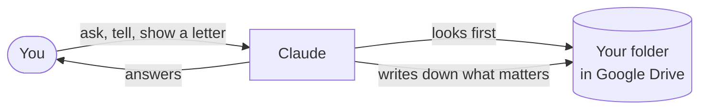

# second-brain-kit

**A second brain in your own Google Drive, looked after by Claude.** Nothing to install and no technical knowledge needed. If you can use Google and a chat, you can use this.

> [!NOTE]
> This is still being tested. The everyday parts work in our tests, but not everything has been tried yet. See [How far along is this?](#how-far-along-is-this)

## What is a second brain?

A second brain is a place outside your head where you keep what you need to remember: what is going on, what you decided and why, what you found out, and what is due when. It is not an archive of everything. It holds the handful of things you would otherwise carry around in your head, or lose.

The idea is older than any app. A notebook, a well-kept folder, a list on the fridge: all of them are second brains. What is new is that an AI assistant can read that place too, and do part of the keeping for you.

## Why you would want one

- **Your head is for thinking, not for storage.** A letter you still have to answer, a deadline, a decision you have not made yet: they take up attention even when you are not working on them. Once they are written down somewhere you trust, you can let go of them.
- **Things get lost between places.** A deadline sits in a letter, an answer in an old chat, a decision in a conversation. A second brain gives each of them one fixed place.
- **An assistant without one starts from zero.** Every new chat either knows nothing about you or relies on a memory you cannot see. With a second brain it starts from what you have written down, and you can check what it knows.
- **It helps most when life is busy.** Letters from offices, a new job, a family with many appointments, learning something new: the more there is to keep track of, the more a fixed place pays off.

## How this one works

You talk to Claude, an AI assistant, in an ordinary chat. Claude keeps your second brain in one folder in your own Google Drive. The folder holds a few ordinary documents that you can open, read and change at any time, like any other document.

Before Claude answers, it looks in your folder. What is written there, Claude knows. What is not written there, Claude does not know, and it says so. Nothing is hidden in Claude's own memory, so you can always see what it knows about you, and correct it.

At the start, Claude asks you a few short questions, eight at most. The most important one: what should your second brain help you with? From your answers it sets up only the parts you need. You can stop at any point and carry on later.

## What it can help with

| Part | What it does for you |
|---|---|
| **Always included** | Where things stand, a box for loose notes, a weekly plan, a diary of what happened, a list of checked facts |
| Appointments and post | Explains letters from offices, banks or debt collectors in plain words and prepares you for appointments |
| Decisions | Helps you think a decision through, and checks it once more before you act |
| Knowledge | Keeps what you looked up, with the source, so you find it again |
| Work | Goals and what is done; turns meeting notes into minutes |
| Writing | Makes your texts clearer and shorter, in your own voice |
| Building | Helps you plan a small app or tool with an AI coding assistant |
| You, family, learning, your tools, anything else | A place for each, if you want one |

Each of these is a small set of instructions for Claude, called a *skill*. The [skills page](skills/README.md) describes each one.

## A normal week

- **A letter arrives.** You take a photo and ask: *"What does this want from me?"* Claude explains in plain words what you have to do and by when. If you say yes, it notes the deadline in your folder.
- **A question about a rule.** *"Is the deadline still 30 days?"* Claude looks for an official source and tells you what it found, or that it could not find one.
- **Once a week.** You write *"weekly review"*. Claude goes through what has piled up, asks three short questions and plans the next week with you.

## How to start

You need:

- a Claude account at [claude.ai](https://claude.ai) (the free plan is enough),
- a Google account. It is best to try this first with a separate Google account that you use only for this,
- about half an hour, ideally at a computer.

Then:

1. Open a new chat at claude.ai.
2. Paste the address of this page and write: *"Set up a second brain for me with this."*
3. Claude explains every step and waits for you. A few clicks only you can do: create a project in Claude, copy in a text that Claude gives you, upload a few files, and allow Claude to use your Google Drive.

If Claude cannot open this page, it asks you to download it and hand over the files. Prefer to do it by hand? The steps are on the [page for developers](DEVELOPERS.md#the-manual-way).

## What you can rely on

- **Claude shows what it did.** One short line at the top of important answers says what it read, and one at the end says where it wrote something. So you can see whether it looked.
- **Numbers, deadlines and rules come with a source.** Without a source, Claude says *unchecked*.
- **Nothing is deleted, and nothing is sent in your name,** unless you clearly say yes.
- **Some things are never written down:** ID, passport, bank account, tax and insurance numbers.

To be honest about it: these are instructions Claude follows, not a lock. In our tests they held in most cases, but not every time. That is exactly why Claude shows that one line: so a slip is easy to spot.

## What it cannot do

- **It is not a lawyer.** For letters and appointments it says what usually applies and where you can get reliable advice.
- **The free plan has a limit.** You can only send a certain number of messages at a time. If you reach it, nothing is lost: everything is already in your folder, and you carry on later.
- **Setting it up works best at a computer.** Writing notes from the phone has been tried, but less often.

## How far along is this?

Most of the everyday parts have run in a test account, with an invented person, in German. Some skills have only been checked on paper so far, and the English version has not been tried in a real account yet. The exact list is on the [page for developers](DEVELOPERS.md#status).

## Your data

Your documents stay in your own Google Drive. This kit collects nothing; it is only a set of instructions. Claude and Google handle your data under their own terms, as with any chat or document you use there. Read the [privacy notice](PRIVACY.md) (a draft, not legal advice). This kit is not made by Anthropic or Google.

## For developers and the curious

How it is built, the full test status, the checks and the plans: [DEVELOPERS.md](DEVELOPERS.md). Want to help? Read [CONTRIBUTING.md](CONTRIBUTING.md).

## License

MIT. You may use, change and pass it on freely. See [LICENSE](LICENSE).
