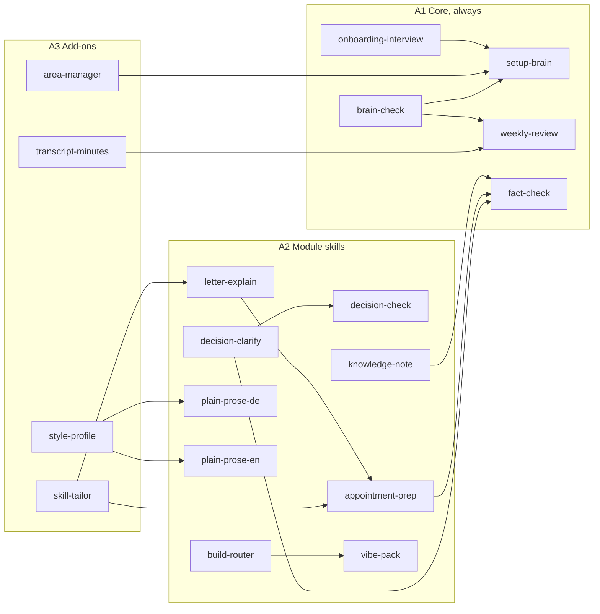
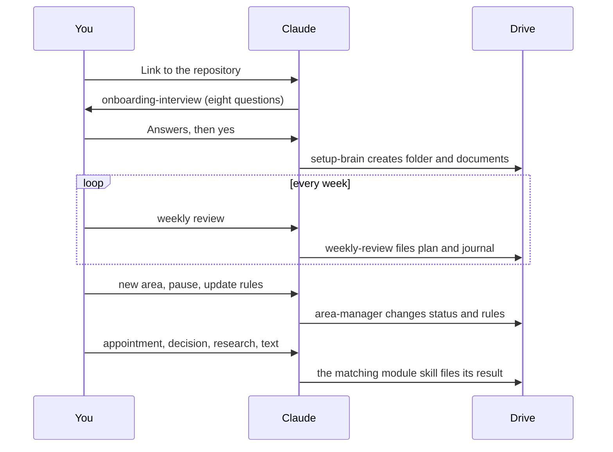

# Skills

Every skill is one `SKILL.md` that Claude loads in claude.ai, packaged as one ZIP per skill. This section has one page per skill: when it starts, how it works as a flow, a short example, its limits, its files and what has really been tested. The [gates page](GATES.md) shows which checks each skill has passed. The skill files themselves (the `SKILL.md` that Claude loads) are in `en/skills` and `de/skills`, the core skills in `en/skeleton/skills` and `de/skeleton/skills`.

## Two kinds of skills

- **A. Out of the box.** Ready-made ZIPs in `de/dist` and `en/dist`.
  - **A1 Core:** always there, five skills.
  - **A2 Module skills:** switched on by the interview, together with the core at most 12 uploads.
  - **A3 Add-ons:** offered when they fit, outside the 12.
- **B. Tailored to you.** Draft, not run in claude.ai: `skill-tailor` reads a template, asks three to five choices and builds a checked ZIP. Templates exist for `appointment-prep` and `letter-explain`; every other skill comes as kind A.

## The map

An arrow means "hands over to" or "feeds": the interview leads to the setup, the style profile feeds both plain-prose skills, the build router hands over to the vibe pack, and so on.

## From first contact to daily use

## All skills

<!-- index:start -->
| Skill | Kind | Area |
|---|---|---|
| [`brain-check`](brain-check.md) | A1 · Core, always | Core |
| [`fact-check`](fact-check.md) | A1 · Core, always | Core |
| [`onboarding-interview`](onboarding-interview.md) | A1 · Core, always | Core |
| [`setup-brain`](setup-brain.md) | A1 · Core, always | Core |
| [`weekly-review`](weekly-review.md) | A1 · Core, always | Core |
| [`appointment-prep`](appointment-prep.md) | A2 · Module skill | Appointments, post and offices (`termine`) |
| [`build-router`](build-router.md) | A2 · Module skill | Build (`bauen`) |
| [`decision-check`](decision-check.md) | A2 · Module skill | Decisions (`entscheidungen`) |
| [`decision-clarify`](decision-clarify.md) | A2 · Module skill | Decisions (`entscheidungen`) |
| [`knowledge-note`](knowledge-note.md) | A2 · Module skill | Knowledge and sources (`wissen`) |
| [`letter-explain`](letter-explain.md) | A2 · Module skill | Appointments, post and offices (`termine`) |
| [`plain-prose-de`](plain-prose-de.md) | A2 · Module skill | Writing style (`schreibstil`) |
| [`plain-prose-en`](plain-prose-en.md) | A2 · Module skill | Writing style (`schreibstil`) |
| [`vibe-pack`](vibe-pack.md) | A2 · Module skill | Build (`bauen`) |
| [`area-manager`](area-manager.md) | A3 · Add-on, outside the upload budget | Core |
| [`skill-tailor`](skill-tailor.md) | A3 · Add-on, outside the upload budget | Core |
| [`style-profile`](style-profile.md) | A3 · Add-on, outside the upload budget | Writing style (`schreibstil`) |
| [`transcript-minutes`](transcript-minutes.md) | A3 · Add-on, outside the upload budget | Work and goals (`arbeit`) |
<!-- index:end -->

## How to read a page

- **Facts** at the top (kind, area, ZIP, size, description) are generated from the `SKILL.md` and the spec and checked at every export by `tools/skill_seiten_pruefen.py`.
- **Flow** is the same procedure as in the skill, drawn. The skill text is authoritative.
- **Status** says what was checked by a tool and what has run in claude.ai. Nothing here claims more than that.
