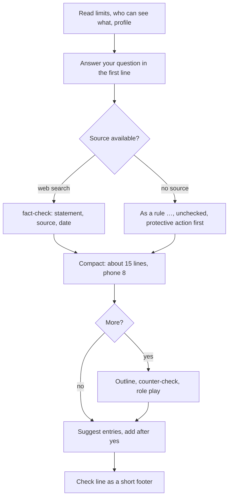

# `appointment-prep`

> Prepares you for an appointment or records afterwards what was agreed: short by default, detailed on request, with one outline and specifics for job centre, immigration office, recognition counselling, job interview, doctor, school and bank.

<!-- facts:start -->
| | |
|---|---|
| Kind | A2 · Module skill |
| Area | Appointments, post and offices (`termine`) |
| Upload | `en/dist/appointment-prep.zip` · `de/dist/appointment-prep.zip` (one skill per ZIP) |
| Size | 7,513 characters (en) · 7,465 characters (de), limit 8,000 for module skills |
| Description | Prepares me for an upcoming appointment or records afterwards what was agreed (employment agency or job centre, immigration office or citizens' office, recognition counselling, job interview, doctor, school, bank and others). Use for "prepare appointment", "what to expect", "how do I prepare" and for "the appointment was today, …". Not for simply adding an appointment to the calendar. A letter with an invitation is explained first by letter-explain. Short by default, detailed on request. |
<!-- facts:end -->

## Triggers
- You write "prepare appointment", "what to expect", "how do I prepare" or "the appointment was today, …".
- Not for simply adding an appointment to the calendar. A letter with an invitation goes to [`letter-explain`](letter-explain.md) first.

## Flow

Knowledge comes in three levels: fresh with a source, "as a rule, unchecked" when a common rule carries the main question, and "usually like this, please ask on site" for tips. Nothing from the last two levels is filed as a fact. Health has three levels (open, appointments only, blocked); with "appointments only" Drive gets "appointment", date and time, at most the town.

## Example

> **You:** Appointment at the immigration office on Friday 9:30 about my residence permit. What do I bring?
> **Claude:** Bring the invitation, your passport and the current permit; which other papers are required is unchecked, please confirm with the office. Three sentences in simple German for the counter: … More?

## Limits
- Never stores ID, passport, residence permit, account, card, tax or insurance numbers, passwords or keys, not even after a yes.
- Sends nothing in your name; texts for third parties name no medical or private reason.
- No legal advice; binding is the authority or court.

## Files
- `en/skills/appointment-prep/SKILL.md` and the German twin.

## Status
- Draft 0.7: simulated only (unit test by sub-agents with invented personas, 22 hard cases, a blind reviewer), not run in claude.ai. The English wording is a first translation and not reviewed.
- Checked by tool: spec, language parity, ZIP rules. No content check tool.

## See also
- [`letter-explain`](letter-explain.md) explains letters and hands invitations over.
- [`fact-check`](fact-check.md) checks the numbers and rules.
