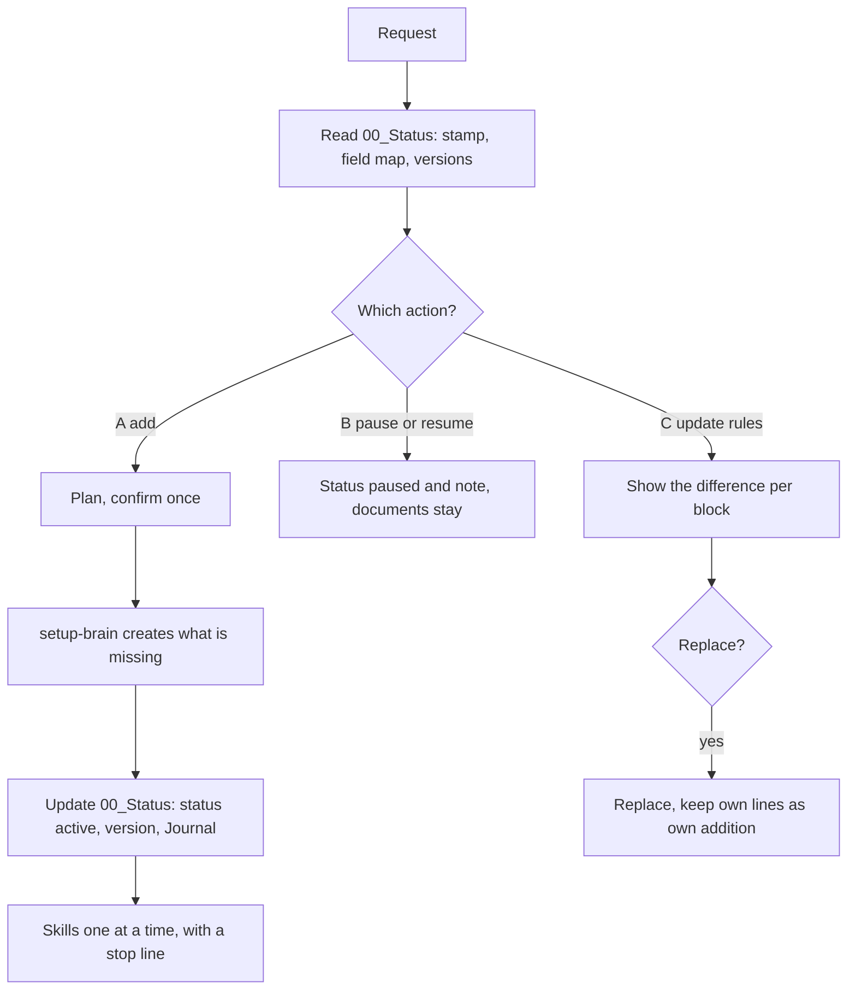

# `area-manager`

> Adds areas while the second brain is in use, pauses them and brings their rules up to date. It changes things only additively, after a yes, and never deletes.

<!-- facts:start -->
| | |
|---|---|
| Kind | A3 · Add-on, outside the upload budget |
| Area | Core |
| Upload | `en/dist/area-manager.zip` · `de/dist/area-manager.zip` (one skill per ZIP) |
| Size | 8,594 characters (en) · 9,092 characters (de), limit 8,000 for module skills |
| Description | Adds areas (modules) while the second brain is in use, pauses them or updates their rules. Use when the person writes "new area", "add an area", "pause an area", "update the rules" or "I also want to use …". Changes only additively and after a yes and never deletes. |
<!-- facts:end -->

## Triggers
- You write "new area", "add an area", "pause an area", "update the rules" or "I also want to use …".

## Flow

Paused areas keep their documents and their rule block with the note "(paused since <date>, do not follow)". Archiving a document is possible only per file after a yes. The skill carries the same area blocks as `setup-brain`, and `tools/skelett.py` checks that they stay word for word identical.

## Example

> **You:** I want to add Learning.
> **Claude:** Plan: 2 documents, no new skill, status line in 00_Status. Shall I do that? (yes/no)

## Limits
- Optional: without it, `setup-brain` creates the areas at the first setup.
- Never deletes and never overwrites your own additions to a block.
- The upload budget of 12 still applies to module skills.

## Files
- `en/skills/area-manager/SKILL.md` and the German twin.
- `tools/nachtraeglich_pruefen.py` computes, per invented persona, what adding an area would trigger (budget, follow-up offers, blocks).

## Status
- Checked by tool: spec, skeleton consistency (blocks, directory, skills), language parity, ZIP rules, mutation test.
- Ran in a free test account on 2026-11-06: an area added, paused and switched on again, each after a preview.

## See also
- [`setup-brain`](setup-brain.md) does the creating.
- [`brain-check`](brain-check.md) finds drift.
