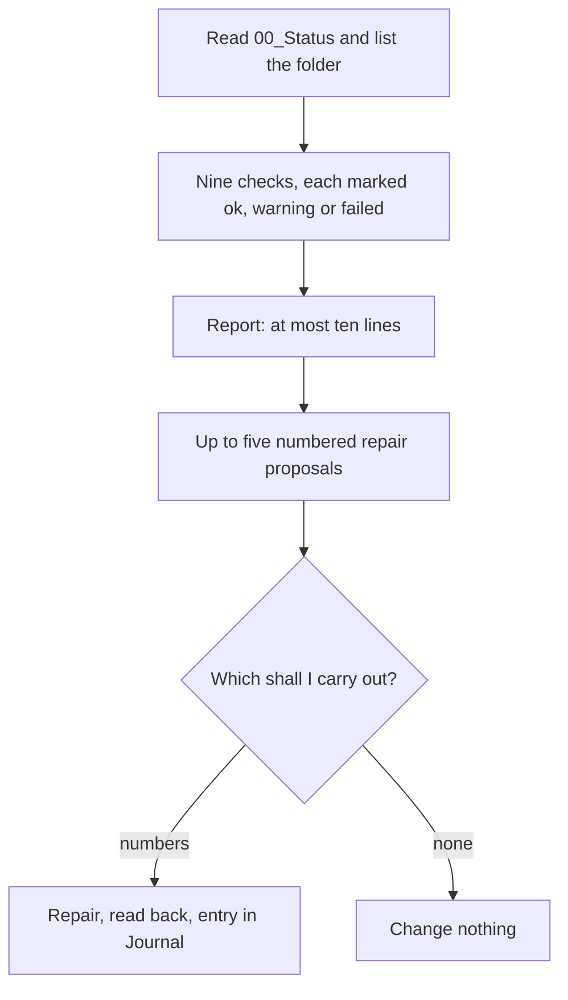

# `brain-check`

> Checks the second brain for order and proposes repairs. It reads first, you decide, and it never deletes.

<!-- facts:start -->
| | |
|---|---|
| Kind | A1 · Core, always |
| Area | Core |
| Upload | `en/dist/brain-check.zip` · `de/dist/brain-check.zip` (one skill per ZIP) |
| Size | 3,125 characters (en) · 3,257 characters (de), limit 8,000 for module skills |
| Description | Checks the second brain for order and proposes repairs. Use when I write "tidy up", "check the structure", "brain-check" or "it is a mess", or when documents are missing or duplicated. Reads first, changes only after my yes and never deletes. |
<!-- facts:end -->

## Why it exists

Any set of documents drifts over time: a duplicate here, a missing section there, an inbox line that has been waiting for a month. This skill looks for that drift. It reads first, reports what it found in a few lines and proposes numbered repairs. You choose which ones run, and nothing is ever deleted.

## Triggers
- You write "tidy up", "check the structure", "brain-check" or "it is a mess".
- Documents are missing or duplicated.

## Flow

The checks cover target against actual, duplicates, documents outside the filing map, area rules, old inbox lines, profile values outside the fixed lists, old entries in the Fact-Ledger, freshness and own areas that resemble a template module. What it could not read is shown as failed with the reason, never guessed.

## Example

> **Claude:** ✓ core documents complete · ⚠ "Journal (1)" looks like a duplicate · ✗ area rules of Learning missing.
> Repairs: 1 add the missing rules · 2 compare the two journals. Which shall I carry out? (numbers, all, none)

## Limits
- Never deletes, shares or changes permissions; works only inside the folder.
- Duplicates are shown side by side and moved to the archive only per file.
- Documents with ID, account, tax or insurance numbers are reported as "sensitive document" without content.

## Files
- `en/skills/brain-check/SKILL.md` and the German twin.

## Status
- Checked by tool: spec, language parity, ZIP rules. No content check tool.
- Ran in a free test account on 2026-11-05: "check structure" started this skill, it changed nothing and proposed repairs.

## See also
- [`setup-brain`](setup-brain.md) creates what is missing.
- [`weekly-review`](weekly-review.md) and [`fact-check`](fact-check.md) take over the follow-ups.
