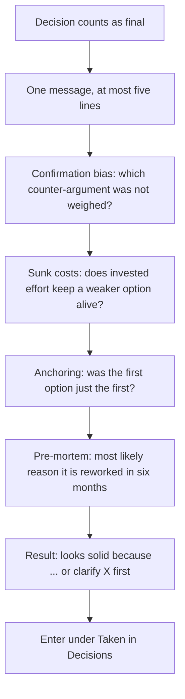

# `decision-check`

> Checks once, briefly, for blind spots when a decision counts as final and before it is acted on: confirmation bias, sunk costs, anchoring and a concrete pre-mortem.

<!-- facts:start -->
| | |
|---|---|
| Kind | A2 · Module skill |
| Area | Decisions (`entscheidungen`) |
| Upload | `en/dist/decision-check.zip` · `de/dist/decision-check.zip` (one skill per ZIP) |
| Size | 1,862 characters (en) · 2,145 characters (de), limit 8,000 for module skills |
| Description | Checks once for blind spots when a decision counts as final and before it is acted on. Use for "I have decided", "we are doing X now", "that is final", "check that again". Looks for confirmation bias, sunk costs and anchoring and poses a concrete pre-mortem. |
<!-- facts:end -->

## Triggers
- You write "I have decided", "we are doing X now", "that is final" or "check that again".

## Flow

Everything arrives in one message, so doubts are not drip-fed. "That was a good decision" is an allowed and useful result. The pre-mortem refers to your situation from the profile, not to a general risk list.

## Example

> **You:** That's final, we move the launch to March.
> **Claude:** Solid because the delay is bounded. Before acting: the March date assumes the supplier answers by January. I would clarify that first. Your call.

## Limits
- Runs once; "skip" skips without discussion for the rest of the session.
- Does not run when an already checked decision is merely repeated or when you are still collecting options.

## Files
- `en/skills/decision-check/SKILL.md` and the German twin.

## Status
- Checked by tool: spec, language parity, ZIP rules. No content check tool.
- Not run in claude.ai.

## See also
- [`decision-clarify`](decision-clarify.md) comes before it.
