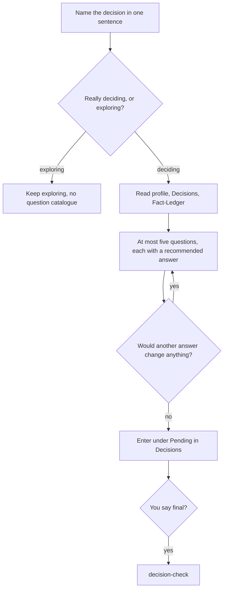

# `decision-clarify`

> Clarifies, before a real decision, the few questions whose other answer would tip it. Every question comes with a recommended answer you can accept in five seconds.

<!-- facts:start -->
| | |
|---|---|
| Kind | A2 · Module skill |
| Area | Decisions (`entscheidungen`) |
| Upload | `en/dist/decision-clarify.zip` · `de/dist/decision-clarify.zip` (one skill per ZIP) |
| Size | 2,114 characters (en) · 2,238 characters (de), limit 8,000 for module skills |
| Description | Clarifies, before a real decision, the few questions whose other answer would tip the decision. Use for "I have to decide", "should I do A or B", "I am thinking about doing X", when a wrong assumption would cost a lot of time, money or opportunity. Not for pure idea collecting. |
<!-- facts:end -->

## Why it exists

Most bad decisions are not made in the final step but rest on an assumption nobody checked. This skill looks for the few questions whose other answer would tip the decision, and asks only those, each with a recommended answer. It stops as soon as no further answer would change anything. The decision itself stays with you.

## Triggers
- You write "I have to decide", "should I do A or B" or "I am thinking about doing X".
- A wrong assumption would cost a lot of time, money or opportunity.

## Flow

It asks only what would invalidate work already done: time frame, money, requirements, circumstances from the profile. Small, easily changed things are bundled in one closing question or left out. It stops as soon as no answer would change anything.

## Example

> **Claude:** I assume you can set aside three evenings a week. Is that right? 1 Yes · 2 No · 3 Don't know.

## Limits
- The decision stays with you; the skill puts the situation in order.
- Never more than ten questions; "skip" ends the questions for this session.
- Decisions imposed from outside (obligation, law) are explained, not clarified.

## Files
- `en/skills/decision-clarify/SKILL.md` and the German twin.

## Status
- Checked by tool: spec, language parity, ZIP rules. No content check tool.
- Ran in a free test account on 2026-11-06 (one open decision, five questions, entry only after yes).

## See also
- [`decision-check`](decision-check.md) follows when you call the decision final.
- [`fact-check`](fact-check.md) for numbers inside the decision.
