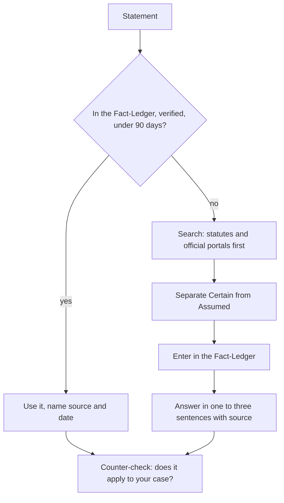

# `fact-check`

> Checks numbers, deadlines, amounts and rules against current official sources before you pass them on or decide on them. Every statement gets a source, a retrieval date and a status.

<!-- facts:start -->
| | |
|---|---|
| Kind | A1 · Core, always |
| Area | Core |
| Upload | `en/dist/fact-check.zip` · `de/dist/fact-check.zip` (one skill per ZIP) |
| Size | 2,369 characters (en) · 2,466 characters (de), limit 8,000 for module skills |
| Description | Checks numbers, deadlines, amounts, requirements and rules against current official sources before I pass them on, apply for something or decide on them. Use for "check that", "is that still true", "fact check" and always before you state a number or rule in a consequential answer. |
<!-- facts:end -->

## Triggers
- You write "check that", "is that still true" or "fact check".
- Other skills call it before a number or rule appears in a consequential answer.

## Flow

The order of sources is statutes and official portals, then the page of the responsible body, then specialist portals. Blogs and forums are hints, never the only source. If sources contradict each other, both are named. If nothing is found it says "unknown", not a guess.

## Example

> **You:** Is the deadline for the form still 30 days?
> **Claude:** Certain: 30 days from the date of the letter (official portal, retrieved today). Assumed: the date on your letter counts, not the date of receipt. For funding and permits the responsible body decides case by case.

## Limits
- Figures from documents you hand over stay "unchecked" until a source confirms them.
- Saying "skip" drops the check, but the statement stays marked unchecked.

## Files
- `en/skills/fact-check/SKILL.md` and the German twin.

## Status
- Checked by tool: spec, language parity, ZIP rules. There is no content check tool.
- Ran in a free test account on 2026-11-05 and 2026-11-10: a new check with an official source and a ledger entry, and a ledger hit without a new web search.

## See also
- [`knowledge-note`](knowledge-note.md), [`appointment-prep`](appointment-prep.md) and [`decision-clarify`](decision-clarify.md) call it.
