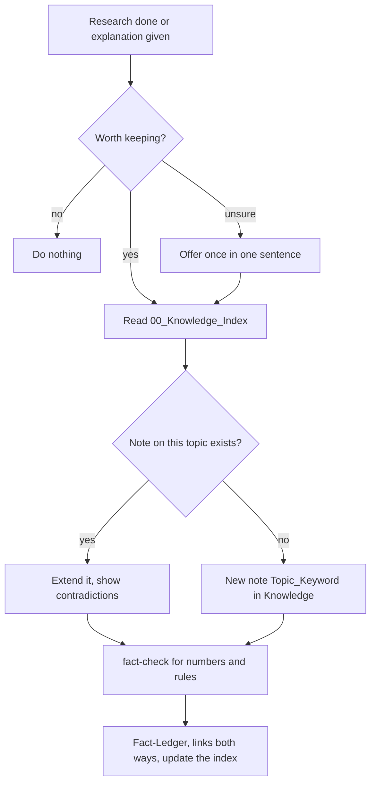

# `knowledge-note`

> Files researched knowledge as one note per topic in the Drive folder Knowledge, with sources, date and status, so later chats find it.

<!-- facts:start -->
| | |
|---|---|
| Kind | A2 · Module skill |
| Area | Knowledge and sources (`wissen`) |
| Upload | `en/dist/knowledge-note.zip` · `de/dist/knowledge-note.zip` (one skill per ZIP) |
| Size | 3,583 characters (en) · 3,775 characters (de), limit 8,000 for module skills |
| Description | Files researched knowledge permanently as a note in the Drive folder Knowledge or extends an existing note, one note per topic. Applies after non-trivial research or explanation that I will need again later, and for "file as knowledge", "remember this as knowledge". Not for everyday questions, appointments or conversations. |
<!-- facts:end -->

## Triggers
- After non-trivial research or a long explanation you will need again.
- You write "file as knowledge" or "remember this as knowledge".

## Flow

A note has a title, a short version, the meaning for you, details, sources with retrieval date and status, what is uncertain, related notes and the date of the last update. Hard facts also go into the `Fact-Ledger`, which stays the source for numbers. A note on money, deadlines or rules older than 90 days is checked before it is used.

## Example

> **Claude:** Filed in Knowledge (topic Funding_Training).

## Limits
- Never files what the limits in `00_Status` block, health data, data of third parties or your personal assessments.
- Does not file word meanings, one-off follow-up questions, single letters, appointments or planning.

## Files
- `en/skills/knowledge-note/SKILL.md` and the German twin.

## Status
- Checked by tool: spec, language parity, ZIP rules. No content check tool.
- Ran in a free test account on 2026-11-05 and 2026-11-06 (one note with sources, index and ledger).

## See also
- [`fact-check`](fact-check.md) is called before filing.
