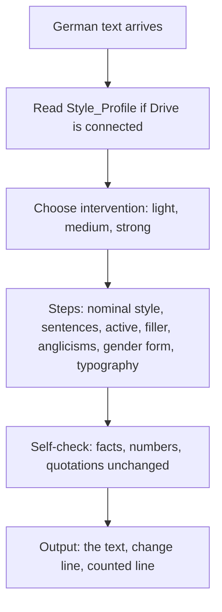

# `plain-prose-de`

> Edits German texts for clarity, brevity and active language, keeps your voice and returns the finished text with a short change line.

<!-- facts:start -->
| | |
|---|---|
| Kind | A2 · Module skill |
| Area | Writing style (`schreibstil`) |
| Upload | `en/dist/plain-prose-de.zip` · `de/dist/plain-prose-de.zip` (one skill per ZIP) |
| Size | 7,881 characters (en) · 7,898 characters (de), limit 8,000 for module skills |
| Description | Edits German texts for clarity, brevity and active language. Use when I paste a German text and write "überarbeiten", "straffen", "kürzer", "klarer", "Klartext", "Floskeln raus" or "klingt nach KI". Keeps my voice from the Style_Profile, invents nothing and returns the finished text with a short change line. For English texts there is plain-prose-en. |
<!-- facts:end -->

## Why it exists

Text written in a hurry, or by a machine, tends to be longer and vaguer than it needs to be. This skill edits German text for clarity, brevity and active language while keeping your voice. It cuts filler before it touches content, invents nothing and tells you in a short line what it changed.

## Triggers
- You paste a German text and write "überarbeiten", "straffen", "kürzer", "klarer", "Klartext", "Floskeln raus" or "klingt nach KI".

## Flow

The default intervention is medium. A length target cuts repetitions and filler first, never statements. The output is plain text without Markdown and a change line (`✎ Geändert`) of at most three lines, plus a line with counted sentence lengths and passive sentences before and after. Intended quirks of your voice stay.

## Example

> **You:** Mach den Text klarer: „Es wurde die Entscheidung getroffen, die Durchführung der Maßnahme zu verschieben.“
> **Claude:** Wir verschieben die Maßnahme. — `✎ Geändert: Nominalstil aufgelöst, Passiv aktiv gemacht.`

## Limits
- Invents nothing and keeps numbers, names and quotations.
- A false alarm that flattens good text weighs more than an overlooked filler phrase.
- English texts go to `plain-prose-en`.

## Files
- `en/skills/plain-prose-de/SKILL.md` and the German original in `de/skills/`.
- `tools/plain_prose_pruefen.py` with 15 evaluation cases, `tools/fixtures/plain-prose/`.

## Status
- Checked by tool: skill checks, self-test, fact diff, count line, language parity, ZIP rules.
- Simulated twice with 15 cases; not run in claude.ai. Test guide: [`docs/plain-prose/Test_claude_ai.md`](../docs/plain-prose/Test_claude_ai.md).

## See also
- [`plain-prose-en`](plain-prose-en.md) for English texts.
- [`style-profile`](style-profile.md) fills the Style_Profile it reads.
