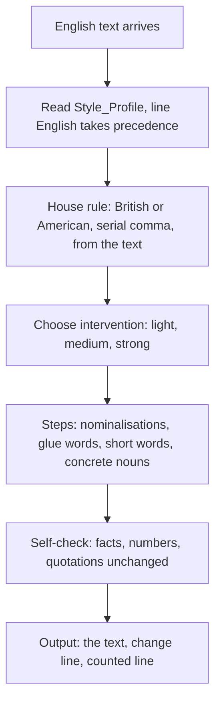

# `plain-prose-en`

> Edits English texts for clarity, brevity and active language. It follows the spelling of the text (British or American) and keeps your voice.

<!-- facts:start -->
| | |
|---|---|
| Kind | A2 · Module skill |
| Area | Writing style (`schreibstil`) |
| Upload | `en/dist/plain-prose-en.zip` · `de/dist/plain-prose-en.zip` (one skill per ZIP) |
| Size | 7,552 characters (en) · 7,678 characters (de), limit 8,000 for module skills |
| Description | Edits English texts for clarity, brevity and active language. Use when I paste an English text and write "edit", "tighten", "make it clearer", "plain prose", "cut the filler" or "sounds like AI". Follows the spelling of the text (British or American), keeps my voice from the Style_Profile, invents nothing and returns the finished text with a short change line. For German texts there is plain-prose-de. |
<!-- facts:end -->

## Why it exists

Text written in a hurry, or by a machine, tends to be longer and vaguer than it needs to be. This skill does for English what its German twin does for German: clearer, shorter, more active, with your voice kept. It follows the spelling the text already uses, British or American, instead of imposing one.

## Triggers
- You paste an English text and write "edit", "tighten", "make it clearer", "plain prose", "cut the filler" or "sounds like AI".

## Flow

If the text mixes spellings, it aligns to the dominant form and says so. Only when nothing is recognisable does it default to British with serial comma. Output rules are the same as in the German twin.

## Example

> **You:** Tighten this: "We made an assessment of the options in order to arrive at a decision."
> **Claude:** We assessed the options to decide. — `✎ Changed: nominalisations to verbs, glue words cut.`

## Limits
- Invents nothing; keeps numbers, names and quotations.
- German texts go to `plain-prose-de`.

## Files
- `en/skills/plain-prose-en/SKILL.md` and the twin in `de/skills/`.
- `tools/plain_prose_pruefen.py`.

## Status
- Checked by tool as for the German twin.
- Simulated twice; not run in claude.ai. Provenance: own work (see [gates](GATES.md)).

## See also
- [`plain-prose-de`](plain-prose-de.md) for German texts.
- [`style-profile`](style-profile.md).
