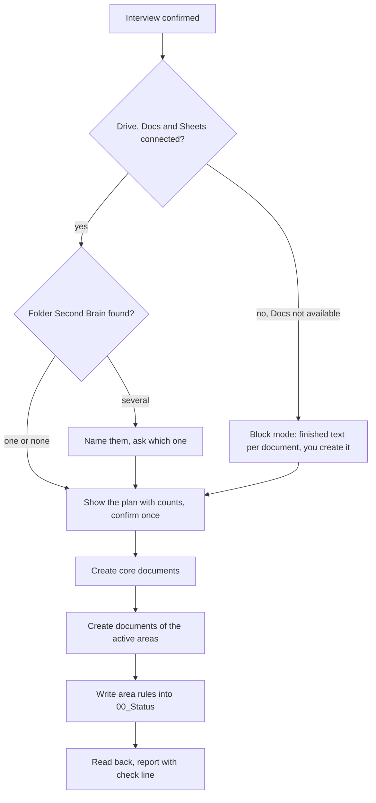

# `setup-brain`

> Creates the Drive structure of your second brain in the chat: the folder, the core documents and the documents of the active areas. It never overwrites anything and can run several times.

<!-- facts:start -->
| | |
|---|---|
| Kind | A1 · Core, always |
| Area | Core |
| Upload | `en/dist/setup-brain.zip` · `de/dist/setup-brain.zip` (one skill per ZIP) |
| Size | 18,478 characters (en) · 19,364 characters (de), limit 8,000 for module skills |
| Description | Creates the Drive structure of the second brain in the chat (folder "Second Brain" with the core documents and the documents of the active areas). Use when I write "set up", "create folder" or "check structure", or when the interview has been confirmed. Never overwrites anything and can run several times. |
<!-- facts:end -->

## Triggers
- After the interview, when you confirm the plan.
- You write "set up", "create folder" or "check structure".

## Flow

The plan names what will be created, with counts, before anything happens. Existing documents are skipped: it creates only what is missing, never overwrites, moves or deletes. The rules of every active area (and the note "paused" for paused ones) end up in the section "Area rules" of `00_Status`. The shared rules (entries with value, status, source and date, limits checked before storing, nothing deleted) apply here exactly as in the interview.

## Example

> **You:** Yes, set it up like this.
> **Claude:** Plan: 1 folder, 8 core entries, 3 documents for your areas. Creating … Done. `🔎 Read: folder ✓ · 📝 Filed: 00_Status, 01_Profile, …`

## Limits
- Never overwrites, moves or deletes; a second run only adds what is missing.
- Needs Google Drive to find and read, and Google Docs and Sheets to create and write. If Docs is not available it switches to block mode instead of failing.
- Writing into documents through the Google Docs connection was seen once in a free test account; the next real run measures whether existing sections are changed in place.

## Files
- `en/skeleton/skills/setup-brain/SKILL.md` and the German twin.
- Checked word for word against the spec by `tools/skelett.py`.

## Status
- Checked by tool: spec, skeleton, language parity, ZIP rules.
- An earlier version ran in a free Claude account (one walkthrough with an invented person). The current version, now more than 14,000 characters long, has not been run in claude.ai.

## See also
- [`onboarding-interview`](onboarding-interview.md) delivers its input.
- [`area-manager`](area-manager.md) adds areas later and calls it.
- [`brain-check`](brain-check.md) repairs what drifted.
