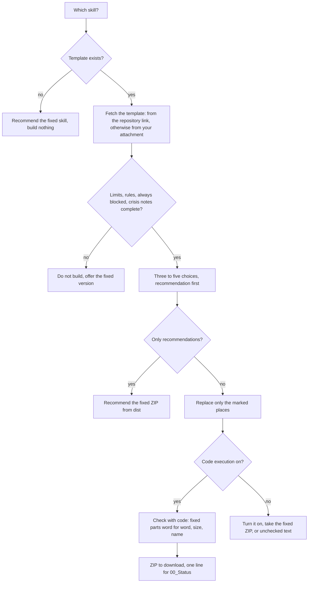

# `skill-tailor`

> Builds a skill from a template in this repository so that it fits you: three to five short choices, then a checked ZIP to upload. Only marked places change; limits, privacy and the check line stay word for word.

<!-- facts:start -->
| | |
|---|---|
| Kind | A3 · Add-on, outside the upload budget |
| Area | Core |
| Upload | `en/dist/skill-tailor.zip` · `de/dist/skill-tailor.zip` (one skill per ZIP) |
| Size | 6,744 characters (en) · 6,972 characters (de), limit 8,000 for module skills |
| Description | Builds a skill from a template in the second brain repository to fit me, after asking me three to five short multiple-choice questions, and gives it out as a ZIP to upload. Use for "tailor a skill", "adapt a skill", "build a skill for me" or when the setup offers a tailored skill. Changes only the marked places; blocks, privacy and the check line stay word for word. |
<!-- facts:end -->

## Triggers
- You ask to tailor, adapt or build a skill for you.
- The setup (START_HERE) offers tailored skills after the core skills.
- Templates exist so far for `appointment-prep` and `letter-explain`. For any other skill it builds nothing and recommends the unchanged skill.

## Flow

## Example

> **You:** Tailor the letter skill for me.
> **Claude:** I read the letters template from the repository. 1a short answers (Recommended) · 1b more detail. 2a drafts only on request (Recommended) · 2b drafts right away when in a hurry …
> **You:** 1a, 2b
> **Claude:** Built and checked: `letter-explain.zip`. Different from the fixed version: drafts come right away when you are in a hurry. Upload it under skills; remove the old one first.

## Limits
- Answers are rules for the skill, not data: no names, numbers, addresses, diagnoses, amounts or login data go into the skill.
- Limits, health levels, who can see what, adding only after a yes, the check line and crisis notes are never changed, not even on request.
- Uploads nothing and changes nothing in your name; you upload the ZIP.

## Files
- `en/skills/skill-tailor/SKILL.md` and the German twin.
- Templates: `en/spec/vorlagen/` and `de/spec/vorlagen/`; checked by `tools/vorlage_pruefen.py`.

## Status
- Draft 0.4 ran once in claude.ai (free plan, German pack, template attached, 2026-11-10): it asked the four questions, built the ZIP and checked it with code; the result passed `tools/vorlage_pruefen.py gegen`, was accepted on upload, and the tailored wording showed in use. In that run Claude typed the template out instead of reading the file. Draft 0.5 reads the template in code from the file; 0.5 has not run in claude.ai yet.
- Checked by tool: templates against the fixed skills (`tools/vorlage_pruefen.py`, with self-test), spec, language parity, ZIP rules.

## See also
- [`appointment-prep`](appointment-prep.md) and [`letter-explain`](letter-explain.md), the two skills with templates.
- [`area-manager`](area-manager.md), the other add-on of the core.
