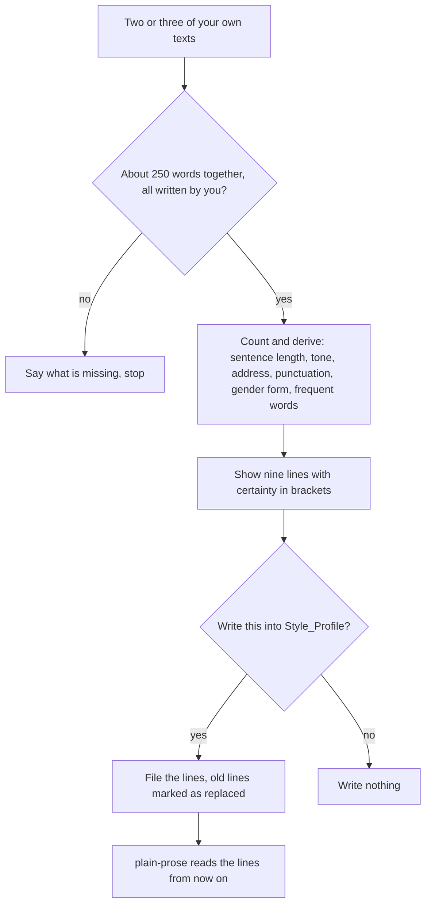

# `style-profile`

> Derives your style profile from two or three of your own texts and, after you agree, files it as lines in the Drive document Style_Profile. Only derived features are stored, never text samples.

<!-- facts:start -->
| | |
|---|---|
| Kind | A3 · Add-on, outside the upload budget |
| Area | Writing style (`schreibstil`) |
| Upload | `en/dist/style-profile.zip` · `de/dist/style-profile.zip` (one skill per ZIP) |
| Size | 4,808 characters (en) · 4,896 characters (de), limit 8,000 for module skills |
| Description | Derives my style profile from two or three of my own texts (sentence length, tone, form of address, punctuation, gender form, frequent words, English house rule) and, after my agreement, files it in the Drive document Style_Profile. Use when I write "create style profile", "learn my style", "how do I write" or "from my texts", or paste my own texts as a style sample. Stores only derived features, never text samples. The skills plain-prose-de and plain-prose-en read the result. |
<!-- facts:end -->

## Triggers
- You write "create style profile", "learn my style", "how do I write" or "from my texts".
- You paste your own texts as a style sample.

## Flow

The nine lines are scope, address, sentence length, tone, gender form, punctuation, English house rule, frequent words and never-used words. Features without evidence read "not recognisable". "Never used" only lists what you named yourself. Under 500 words the result counts as provisional.

## Example

> **Claude:** Sentence length: usually 8 to 16 words, rarely over 28 (counted, from 3 texts) · Tone: dry (medium) · … Shall I write this into the Style_Profile like this? You can strike or change lines.

## Limits
- Forwarded mails, quotations, templates and AI drafts do not count as your texts.
- No names, places, companies, numbers, health, child or money details; no word sequence from the texts.
- No inferences about you (age, origin, mood, character).
- Nothing is deleted: a contradicting new line marks the old one "replaced on".

## Files
- `en/skills/style-profile/SKILL.md` and the German twin.
- `tools/style_profile_pruefen.py`, six invented cases in `tools/fixtures/style-profile/`.
- Documentation and test guide: [`Skill_Doku.md`](../docs/style-profile/Skill_Doku.md).

## Status
- Checked by tool: skill check and self-test. Not simulated and not run in claude.ai.

## See also
- [`plain-prose-de`](plain-prose-de.md) and [`plain-prose-en`](plain-prose-en.md) read the profile.
