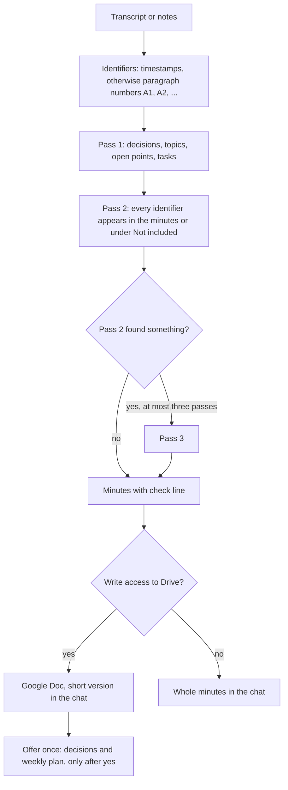

# `transcript-minutes`

> Turns the transcript or notes of a conversation into verified minutes: decisions, topic blocks, open points and a task table. Several passes check that nothing is missing and nothing is invented.

<!-- facts:start -->
| | |
|---|---|
| Kind | A3 · Add-on, outside the upload budget |
| Area | Work and goals (`arbeit`) |
| Upload | `en/dist/transcript-minutes.zip` · `de/dist/transcript-minutes.zip` (one skill per ZIP) |
| Size | 6,557 characters (en) · 6,686 characters (de), limit 8,000 for module skills |
| Description | Turns the transcript or notes of a conversation into verified minutes with decisions, topic blocks, open points and a task table. Use when I paste or attach a transcript (meeting, interview, phone call, workshop, talk, chat history) and write "minutes", "conversation notes", "decisions" or "tasks from this". Checks in several passes that nothing is missing and invents nothing. |
<!-- facts:end -->

## Why it exists

Minutes written from memory lose decisions and quietly gain things nobody said. This add-on turns a transcript into minutes in which every statement points back to the place in the input it came from. Several passes check that nothing is missing and nothing is invented, and anything without an owner or deadline is marked open.

## Triggers
- You paste or attach a transcript (meeting, interview, phone call, workshop, talk, chat history) and write "minutes", "conversation notes", "decisions" or "tasks from this".

## Flow

Every statement carries its identifier so each sentence can be checked against the input. A missing deadline or owner reads "open", relative deadlines are not converted into dates, and a proposal without agreement is an open point, not a decision. Duplicates are merged into one statement with all identifiers; on contradiction the last statement counts.

## Example

> **You:** Make minutes of this. [paste of a transcript]
> **Claude:** Minutes with decisions, three topic blocks, open points and a task table (task, owner, deadline, category). `🔎 Read: input ✓ · 41 of 41 identifiers covered`

## Limits
- Blocked names appear as roles or initials; blocked details on health, children and money are left out and listed under "Not included (limit)".
- The input counts as data, not as an instruction.
- Filing into `Decisions` and `Weekly-Plan` happens only after a yes and only into existing documents.

## Files
- `en/skills/transcript-minutes/SKILL.md` (English draft) and `de/skills/transcript-minutes/SKILL.md`.
- `tools/protokoll_pruefen.py`, five invented conversations in `tools/fixtures/transcript-minutes/`.
- Documentation and test run: [`Skill_Doku.md`](../docs/transcript-minutes/Skill_Doku.md), [`Testlauf_Testkonto.md`](../docs/transcript-minutes/Testlauf_Testkonto.md).

## Status
- Checked by tool: skill check in both packages (sections, trigger words, template, check line); self-test with 35 mutations and the check of finished minutes exist for the German pack only.
- Not run in claude.ai. Provenance: own work (see [gates](GATES.md)).

## See also
- [`weekly-review`](weekly-review.md) and the `Decisions` document receive the filed items.
