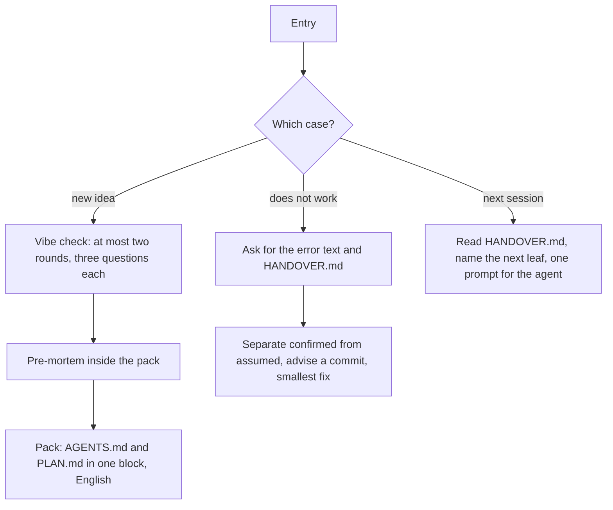

# `vibe-pack`

> Turns a vague idea into a pack for a coding agent (for example Cursor, Windsurf or Replit): a rules file and a build plan. It also helps when a built project does not run or continues in a new session.

<!-- facts:start -->
| | |
|---|---|
| Kind | A2 · Module skill |
| Area | Build (`bauen`) |
| Upload | `en/dist/vibe-pack.zip` · `de/dist/vibe-pack.zip` (one skill per ZIP) |
| Size | 6,804 characters (en) · 7,007 characters (de), limit 8,000 for module skills |
| Description | Turns a vague idea into a pack for a coding agent (for example Cursor, Windsurf or Replit), namely a rules file and a build plan. Use when I want to build an app, a script or a tool, when my built project does not run, or when I want to continue it in a new session. Not for automated workflows between existing services such as mail, spreadsheets or calendar. |
<!-- facts:end -->

## Triggers
- You want to build an app, a script or a tool.
- Your built project does not run, or you want to continue in a new session.

## Flow

The pack is one block with the marker lines `=== AGENTS.md ===` (eight rules, under 2,000 characters) and `=== PLAN.md ===` (a tracer first, at most five leaf tasks, each with an expected result). The names of rules files are checked against the current docs of the tool or marked unchecked. If the app has an AI feature, a fixed block of AI rules is added word for word.

## Example

> **You:** I want a shopping list I can tick off on my phone.
> **Claude:** Two questions, recommendation first: … Then one block with AGENTS.md and PLAN.md in English.

## Limits
- Real data never goes into the pack; invented sample data only until acceptance.
- No monolith: the first step is always the smallest path from input to visible output.
- Not for automated workflows between existing services; that is the workflow skill.

## Files
- `en/skills/vibe-pack/SKILL.md` and the German twin.
- `tools/pack_pruefen.py`; test guide [`docs/vibe-pack/Testlauf_vibe-pack.md`](../docs/vibe-pack/Testlauf_vibe-pack.md).

## Status
- Checked by tool: skill check in both packages, pack patterns and self-test (German pack), language parity, ZIP rules.
- Not run in claude.ai. Provenance: own work (see [gates](GATES.md)).

## See also
- [`build-router`](build-router.md) hands over to it.
