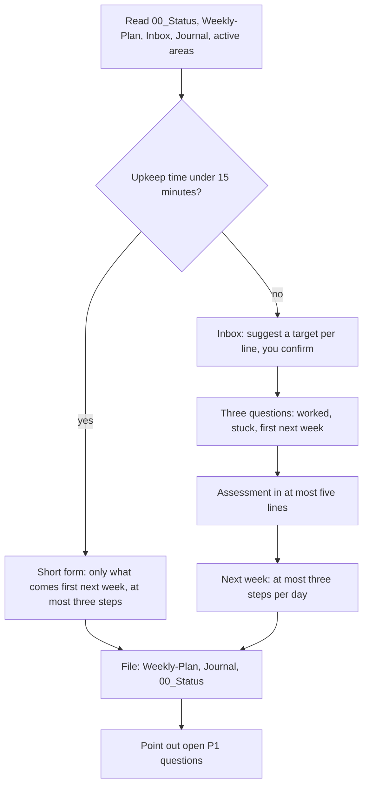

# `weekly-review`

> Sorts the inbox, asks three short questions, writes the weekly plan and the journal, and suggests the next week. With little time it shrinks to one question.

<!-- facts:start -->
| | |
|---|---|
| Kind | A1 · Core, always |
| Area | Core |
| Upload | `en/dist/weekly-review.zip` · `de/dist/weekly-review.zip` (one skill per ZIP) |
| Size | 4,979 characters (en) · 5,265 characters (de), limit 8,000 for module skills |
| Description | Weekly review and planning for the second brain. Use when I write "weekly review" or "weekly plan" or ask where I stand. Sorts the inbox, updates the weekly plan and the journal and suggests the next week. |
<!-- facts:end -->

## Why it exists

Notes pile up in the inbox, plans go stale, and after a few weeks the second brain no longer matches your life. The weekly review is the one routine that keeps it current. It sorts the inbox with you, asks three short questions and writes the plan for the next week. When time is short it shrinks to a single question rather than being skipped.

## Triggers
- You write "weekly review" or "weekly plan", or ask where you stand.

## Flow

Done only counts with evidence (confirmation, date, document). Numbers and deadlines you mention stay "unchecked" until a source is in the `Fact-Ledger`. The inbox lines are marked as filed, never deleted. The shared rules (limits before storing, no overwriting of old values) apply as in the interview.

## Example

> **You:** weekly review
> **Claude:** Inbox: 3 lines open. Line 1 looks like a note on the heating contract. Shall I file it under Appointments? …

## Limits
- Deletes nothing, writes no ID, account, tax or insurance numbers.
- Plans no more than three steps per day and fits them to your upkeep time.

## Files
- `en/skeleton/skills/weekly-review/SKILL.md` and the German twin.

## Status
- Checked by tool: spec, skeleton, shared rules word for word, language parity, ZIP rules.
- The current version ran in a free test account on 2026-11-10: inbox sorted, three questions and the monthly question, plan, filing; checked against a Drive export.

## See also
- [`brain-check`](brain-check.md) points here when the inbox is old.
- [`fact-check`](fact-check.md) clears deadlines and numbers.
